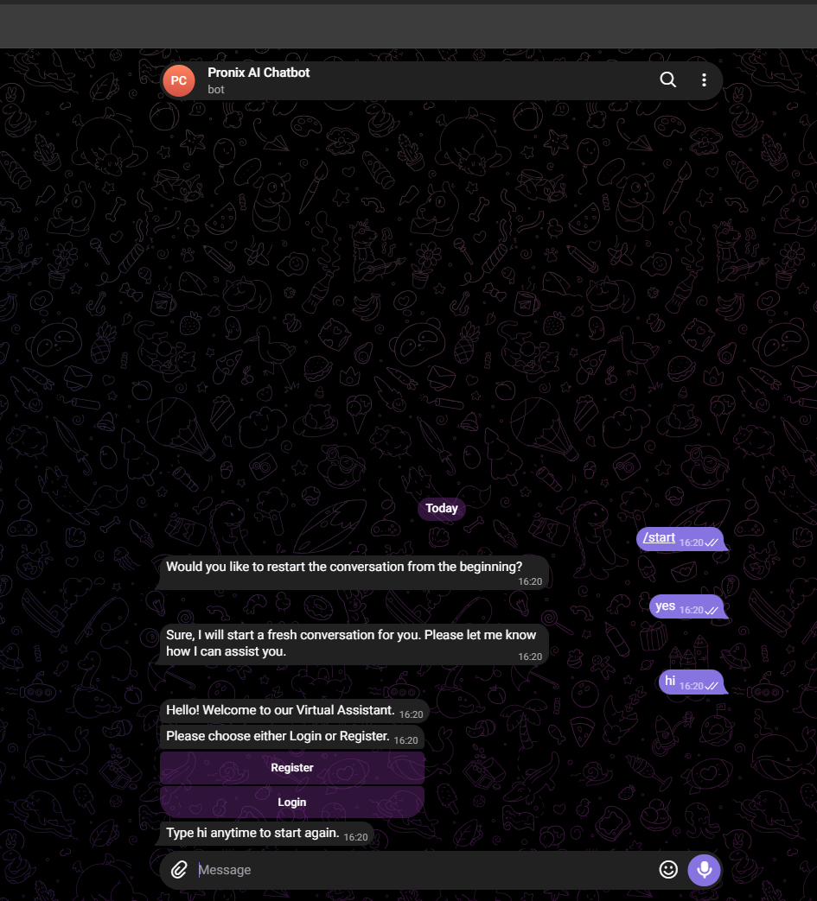
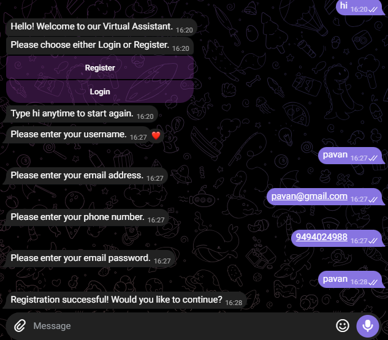
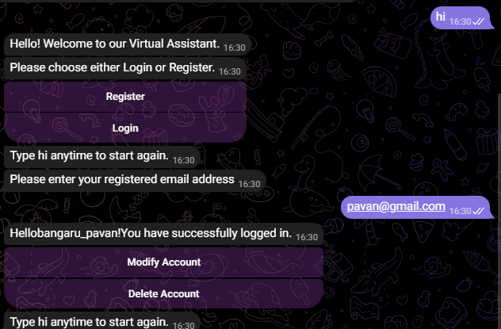
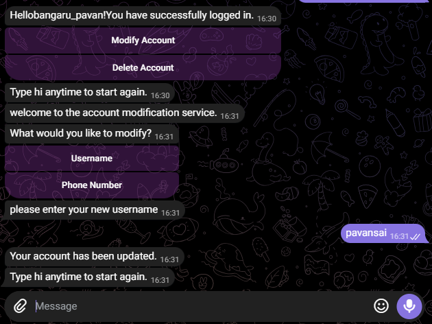
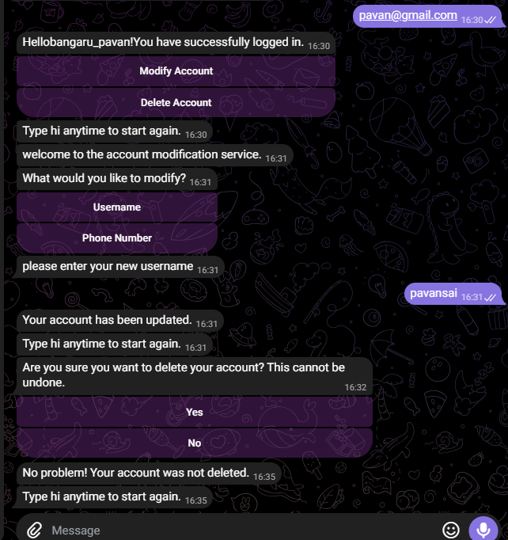

# Pronix AI Chatbot

An AI-powered virtual assistant developed using the **Kore.ai XO Platform**, integrated with Telegram to provide account management services and company information responses.

## Project Overview

Pronix AI Chatbot is a conversational virtual assistant designed to help users interact with account-related services and obtain information about Pronix.

The chatbot provides registration, email-based login verification, account modification, account deletion, and company information search through a conversational interface.

## Key Features

### 1. Welcome Interface
- Displays a welcome message.
- Provides Login and Register options.

### 2. User Registration
- Collects username, email, phone number, and password.
- Sends registration details to a Custom Service.
- Integrates with MockAPI.
- Displays registration success or failure messages.

### 3. User Login
- Accepts the user's registered email address.
- Verifies email registration through a Custom Service.
- Checks the API response status code.
- Provides Register Now, Retry, and Cancel options when the email is not registered.

**Note:** Login currently uses email-based verification and does not request password authentication.

### 4. Modify Account
- Allows users to modify their username.
- Allows users to update their phone number.
- Sends updated information through a Custom Service.
- Displays success or error messages.

### 5. Delete Account
- Asks for confirmation before deleting an account.
- Provides Yes and No options.
- Processes the deletion through a Custom Service.
- Displays appropriate success or failure messages.

### 6. Company Information Search
- Uses the Kore.ai Search AI feature.
- Handles company-related questions.
- Uses a Script node to process Search AI responses.
- Provides the Pronix website link in the demonstrated response.

## Technology Stack

| Technology | Purpose |
|---|---|
| Kore.ai XO Platform | Chatbot development |
| Dialog Tasks | Conversational workflows |
| Intents and Entities | User input handling |
| Search AI | Company information queries |
| Custom Services | API integration |
| MockAPI | Account data operations |
| JavaScript | Script node processing |
| Telegram | Chatbot deployment |


## Project Screenshots

### 1. Telegram Chatbot


### 2. User Registration Workflow


### 3. User Login Workflow


### 4. Modify Account


### 5. Delete Account


## Chatbot Workflow

```text
                User
                 |
                 v
           Welcome Message
                 |
          Login / Register
             /       \
            /         \
      Registration    Login
           |            |
     Collect Details  Enter Email
           |            |
      Register API   Login API
           |            |
      Confirmation   Check Status
                         |
                  +------+------+
                  |             |
                200          Not 200
                  |             |
             Login Flow    Register / Retry
                  |
          Account Management
              /       \
             /         \
        Modify       Delete
        Account      Account
```

Company information queries are handled separately through Search AI.

## Live Demo

- **Telegram Bot:** https://t.me/Pronix_AI_Pavan
- **Kore.ai Web Client:** https://platform.kore.ai/xo-webclient/b6945fb69b4946fca087584418f0fb33a23b4ab1f1e347b49907ea01f679a263st00?lang=en
- **Project Demo Video:** [Watch the demonstration](https://drive.google.com/file/d/1RHqQSoYEh6PGB5DHDGUoe04CnNc_hQ66/view?usp=drive_link)

## Learning Outcomes

Through this project, I gained practical experience in:

- Building conversational applications using Kore.ai XO Platform.
- Designing dialog tasks and chatbot workflows.
- Working with intents and entities.
- Configuring Kore.ai Custom Services to connect with MockAPI.
- Connecting chatbot workflows with MockAPI.
- Processing responses using JavaScript Script nodes.
- Implementing Search AI functionality.
- Deploying a chatbot on Telegram.

## Author

**Bangaru Pavan Sai**

- GitHub: [Pavansai1210](https://github.com/Pavansai1210)
- Project Repository: [Pronix AI Chatbot](https://github.com/Pavansai1210/Pronix-AI-Chatbot)
